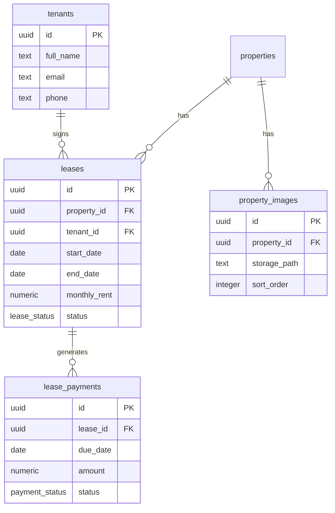

# MIR Housing — Database Architecture

## Overview

MIR Housing uses **PostgreSQL** hosted on **Supabase** as its primary data store. Authentication is handled by **Supabase Auth** (`auth.users`). Application data lives in the `public` schema and is protected by **Row Level Security (RLS)**.

This document defines the schema for **Phase 1** (property CRUD for internal staff) and sketches **Phase 2+** tables so the design can grow without breaking changes.

**Related docs:** [purpose.md](./purpose.md)

---

## Design Principles

| Principle | Description |
|-----------|-------------|
| **Single company** | One internal organization; no multi-tenant `company_id` in Phase 1 |
| **Auth via Supabase** | Staff accounts live in `auth.users`; app tables reference `auth.users.id` |
| **RLS first** | All `public` tables have RLS enabled; anonymous users cannot read property data |
| **API-mediated writes** | NestJS uses the Supabase client with the user's JWT (anon key + user token) or service role only for admin tasks |
| **Audit-friendly** | `created_at`, `updated_at`, and `created_by` on mutable records |
| **Soft delete (recommended)** | `deleted_at` on `properties` preserves history; hard delete optional later |

---

## High-Level Architecture

```
┌─────────────────────────────────────────────────────────────────┐
│                        Supabase Project                          │
├─────────────────────────────────────────────────────────────────┤
│  auth schema (managed)                                           │
│    └── users          ← email/password login for staff           │
├─────────────────────────────────────────────────────────────────┤
│  public schema (application)                                     │
│    ├── profiles       ← staff profile (1:1 with auth.users)      │
│    └── properties     ← rental property records (Phase 1)        │
│                                                                  │
│  [Phase 2+] tenants, leases, lease_payments, property_images     │
├─────────────────────────────────────────────────────────────────┤
│  storage (Phase 2+)                                              │
│    └── property-images bucket                                    │
└─────────────────────────────────────────────────────────────────┘
         ▲                              ▲
         │ JWT (authenticated)          │ REST + Bearer token
         │                                │
    Next.js client                   NestJS server
```

---

## Entity Relationship Diagram

### Phase 1

```mermaid
erDiagram
    auth_users ||--|| profiles : "has"
    auth_users ||--o{ properties : "created_by"
    profiles ||--o{ properties : "manages"

    auth_users {
        uuid id PK
        text email
        timestamptz created_at
    }

    profiles {
        uuid id PK_FK
        text full_name
        text role
        timestamptz created_at
        timestamptz updated_at
    }

    properties {
        uuid id PK
        text name
        text property_type
        property_status status
        text address_line1
        text address_line2
        text city
        text province
        text postal_code
        text country
        numeric rent_amount
        text rent_currency
        integer bedrooms
        numeric bathrooms
        numeric area_sqm
        text description
        text internal_notes
        uuid created_by FK
        timestamptz created_at
        timestamptz updated_at
        timestamptz deleted_at
    }
```

### Phase 2+ (planned, not implemented)



---

## Schemas & Namespaces

| Schema | Owner | Purpose |
|--------|-------|---------|
| `auth` | Supabase | Users, sessions, identities — do not modify directly except via Auth API |
| `public` | Application | All MIR Housing business tables |
| `storage` | Supabase | File buckets (Phase 2+) |

---

## Enums

### `property_status`

Lifecycle state of a rental unit.

| Value | Description |
|-------|-------------|
| `available` | Ready to rent |
| `rented` | Currently occupied |
| `maintenance` | Under repair or renovation |
| `inactive` | Off market / not in use |

### `property_type`

| Value | Description |
|-------|-------------|
| `house` | Single-family house |
| `condo` | Condominium unit |
| `apartment` | Apartment unit |
| `townhouse` | Townhouse |
| `other` | Other property type |

### `staff_role` (Phase 1 — single role; extensible)

| Value | Description |
|-------|-------------|
| `staff` | Default internal user; full property CRUD in Phase 1 |
| `admin` | Future: user management, destructive actions |

---

## Tables — Phase 1

### `public.profiles`

Extends `auth.users` with display and role metadata. Created automatically when a user signs up (via trigger) or on first login.

| Column | Type | Nullable | Default | Description |
|--------|------|----------|---------|-------------|
| `id` | `uuid` | NO | — | PK, FK → `auth.users.id` ON DELETE CASCADE |
| `full_name` | `text` | YES | — | Display name |
| `role` | `staff_role` | NO | `'staff'` | Access role (Phase 1: all staff equal) |
| `created_at` | `timestamptz` | NO | `now()` | Profile created |
| `updated_at` | `timestamptz` | NO | `now()` | Last profile update |

**Constraints**
- Primary key: `id`
- Foreign key: `id` → `auth.users(id)` ON DELETE CASCADE

**Indexes**
- Primary key on `id` (implicit)

---

### `public.properties`

Core entity for Phase 1 property CRUD.

| Column | Type | Nullable | Default | Description |
|--------|------|----------|---------|-------------|
| `id` | `uuid` | NO | `gen_random_uuid()` | Primary key |
| `name` | `text` | NO | — | Short label, e.g. "Sunset Villa Unit 3B" |
| `property_type` | `property_type` | NO | `'house'` | Building type |
| `status` | `property_status` | NO | `'available'` | Current availability |
| `address_line1` | `text` | NO | — | Street address |
| `address_line2` | `text` | YES | — | Unit, floor, building |
| `city` | `text` | NO | — | City |
| `province` | `text` | NO | — | State / province |
| `postal_code` | `text` | YES | — | ZIP / postal code |
| `country` | `text` | NO | `'TH'` | ISO country code or name |
| `rent_amount` | `numeric(12,2)` | YES | — | Monthly rent |
| `rent_currency` | `text` | NO | `'THB'` | ISO 4217 currency code |
| `bedrooms` | `integer` | YES | — | Bedroom count |
| `bathrooms` | `numeric(3,1)` | YES | — | e.g. 1.5, 2.0 |
| `area_sqm` | `numeric(10,2)` | YES | — | Floor area in square meters |
| `description` | `text` | YES | — | Public-facing description for staff |
| `internal_notes` | `text` | YES | — | Staff-only notes |
| `zalo_group_link` | `text` | YES | — | Zalo group URL for the property |
| `created_by` | `uuid` | YES | — | FK → `auth.users.id` |
| `created_at` | `timestamptz` | NO | `now()` | Record created |
| `updated_at` | `timestamptz` | NO | `now()` | Last modified |
| `deleted_at` | `timestamptz` | YES | — | Soft delete timestamp; NULL = active |

**Constraints**
- Primary key: `id`
- Foreign key: `created_by` → `auth.users(id)` ON DELETE SET NULL
- Check: `rent_amount >= 0` (when not null)
- Check: `bedrooms >= 0` (when not null)
- Check: `bathrooms >= 0` (when not null)
- Check: `area_sqm > 0` (when not null)

**Indexes**

| Index | Columns | Purpose |
|-------|---------|---------|
| `idx_properties_status` | `status` | Filter dashboard by status |
| `idx_properties_deleted_at` | `deleted_at` | Exclude soft-deleted rows (`WHERE deleted_at IS NULL`) |
| `idx_properties_city` | `city` | Search / filter by location |
| `idx_properties_created_at` | `created_at DESC` | Recent-first listing |

**Computed display (application layer, not stored)**

Full address for UI:

```
address_line1, address_line2, city, province postal_code, country
```

---

## Row Level Security (RLS)

RLS is **enabled** on all `public` tables. Phase 1 uses a simple model: any authenticated staff member can read and write all properties.

### `profiles`

| Policy | Operation | Rule |
|--------|-----------|------|
| Users read own profile | `SELECT` | `auth.uid() = id` |
| Users update own profile | `UPDATE` | `auth.uid() = id` |
| Insert on signup | `INSERT` | `auth.uid() = id` (via trigger or service) |

### `properties`

| Policy | Operation | Rule |
|--------|-----------|------|
| Staff read active properties | `SELECT` | `auth.role() = 'authenticated' AND deleted_at IS NULL` |
| Staff read all (incl. deleted) | `SELECT` | Optional admin-only in Phase 2 |
| Staff insert | `INSERT` | `auth.role() = 'authenticated'` |
| Staff update | `UPDATE` | `auth.role() = 'authenticated' AND deleted_at IS NULL` |
| Staff soft delete | `UPDATE` | Set `deleted_at = now()` via API (same UPDATE policy) |

**Anonymous access:** denied on all application tables.

**Service role:** NestJS may use `SUPABASE_SERVICE_ROLE_KEY` only for trusted server jobs (e.g. signup hook, migrations). Prefer passing the user's JWT from the client for normal CRUD so RLS applies.

---

## Triggers & Functions

### `set_updated_at()`

Generic trigger function to set `updated_at = now()` on row update.

Applied to: `profiles`, `properties`

### `handle_new_user()`

On `auth.users` INSERT, create a row in `public.profiles`:

```sql
insert into public.profiles (id, full_name)
values (new.id, new.raw_user_meta_data->>'full_name');
```

---

## Phase 1 SQL Migration (reference)

Run in Supabase SQL Editor or via migration files.

```sql
-- Enums
create type public.property_status as enum (
  'available', 'rented', 'maintenance', 'inactive'
);

create type public.property_type as enum (
  'house', 'condo', 'apartment', 'townhouse', 'other'
);

create type public.staff_role as enum ('staff', 'admin');

-- Profiles
create table public.profiles (
  id uuid primary key references auth.users (id) on delete cascade,
  full_name text,
  role public.staff_role not null default 'staff',
  created_at timestamptz not null default now(),
  updated_at timestamptz not null default now()
);

alter table public.profiles enable row level security;

create policy "Users can view own profile"
  on public.profiles for select
  using (auth.uid() = id);

create policy "Users can update own profile"
  on public.profiles for update
  using (auth.uid() = id);

-- Properties
create table public.properties (
  id uuid primary key default gen_random_uuid(),
  name text not null,
  property_type public.property_type not null default 'house',
  status public.property_status not null default 'available',
  address_line1 text not null,
  address_line2 text,
  city text not null,
  province text not null,
  postal_code text,
  country text not null default 'TH',
  rent_amount numeric(12, 2),
  rent_currency text not null default 'THB',
  bedrooms integer,
  bathrooms numeric(3, 1),
  area_sqm numeric(10, 2),
  description text,
  internal_notes text,
  zalo_group_link text,
  created_by uuid references auth.users (id) on delete set null,
  created_at timestamptz not null default now(),
  updated_at timestamptz not null default now(),
  deleted_at timestamptz,
  constraint properties_rent_amount_nonneg check (rent_amount is null or rent_amount >= 0),
  constraint properties_bedrooms_nonneg check (bedrooms is null or bedrooms >= 0),
  constraint properties_bathrooms_nonneg check (bathrooms is null or bathrooms >= 0),
  constraint properties_area_positive check (area_sqm is null or area_sqm > 0)
);

create index idx_properties_status on public.properties (status);
create index idx_properties_deleted_at on public.properties (deleted_at);
create index idx_properties_city on public.properties (city);
create index idx_properties_created_at on public.properties (created_at desc);

alter table public.properties enable row level security;

create policy "Authenticated users can read properties"
  on public.properties for select
  to authenticated
  using (deleted_at is null);

create policy "Authenticated users can insert properties"
  on public.properties for insert
  to authenticated
  with check (true);

create policy "Authenticated users can update properties"
  on public.properties for update
  to authenticated
  using (deleted_at is null)
  with check (true);

-- updated_at trigger
create or replace function public.set_updated_at()
returns trigger as $$
begin
  new.updated_at = now();
  return new;
end;
$$ language plpgsql;

create trigger profiles_updated_at
  before update on public.profiles
  for each row execute function public.set_updated_at();

create trigger properties_updated_at
  before update on public.properties
  for each row execute function public.set_updated_at();

-- Auto-create profile on signup
create or replace function public.handle_new_user()
returns trigger as $$
begin
  insert into public.profiles (id, full_name)
  values (new.id, new.raw_user_meta_data->>'full_name');
  return new;
end;
$$ language plpgsql security definer;

create trigger on_auth_user_created
  after insert on auth.users
  for each row execute function public.handle_new_user();
```

---

## API ↔ Database Mapping (Phase 1)

| API endpoint | SQL operation | Notes |
|--------------|---------------|-------|
| `GET /properties` | `SELECT * FROM properties WHERE deleted_at IS NULL ORDER BY created_at DESC` | Optional `?status=` filter |
| `GET /properties/:id` | `SELECT * FROM properties WHERE id = $1 AND deleted_at IS NULL` | 404 if missing or deleted |
| `POST /properties` | `INSERT INTO properties (...)` | Set `created_by` from JWT `sub` |
| `PATCH /properties/:id` | `UPDATE properties SET ... WHERE id = $1` | Partial updates |
| `DELETE /properties/:id` | `UPDATE properties SET deleted_at = now() WHERE id = $1` | Soft delete |

---

## TypeScript Types (reference)

```typescript
type PropertyStatus = 'available' | 'rented' | 'maintenance' | 'inactive';
type PropertyType = 'house' | 'condo' | 'apartment' | 'townhouse' | 'other';
type StaffRole = 'staff' | 'admin';

interface Profile {
  id: string;
  full_name: string | null;
  role: StaffRole;
  created_at: string;
  updated_at: string;
}

interface Property {
  id: string;
  name: string;
  property_type: PropertyType;
  status: PropertyStatus;
  address_line1: string;
  address_line2: string | null;
  city: string;
  province: string;
  postal_code: string | null;
  country: string;
  rent_amount: number | null;
  rent_currency: string;
  bedrooms: number | null;
  bathrooms: number | null;
  area_sqm: number | null;
  description: string | null;
  internal_notes: string | null;
  zalo_group_link: string | null;
  created_by: string | null;
  created_at: string;
  updated_at: string;
  deleted_at: string | null;
}
```

---

## Phase 2+ Tables (planned)

Not in scope for initial implementation; included for forward compatibility.

| Table | Purpose |
|-------|---------|
| `tenants` | Tenant contact and identity |
| `leases` | Links property + tenant, dates, rent terms |
| `lease_payments` | Rent due dates and payment status |
| `property_images` | Metadata for images in Supabase Storage |

When added, `properties.status = 'rented'` should stay in sync with an active `leases` row (via app logic or trigger in Phase 2).

---

## Migration Strategy

1. **Versioned SQL files** — Store migrations under `server/supabase/migrations/` (or Supabase CLI `supabase/migrations/`).
2. **Naming** — `YYYYMMDDHHMMSS_description.sql`
3. **Never edit production-applied migrations** — Add new migration files for changes.
4. **Local dev** — Apply via Supabase Dashboard SQL Editor or `supabase db push`.
5. **Seed data** — Optional `seed.sql` with sample properties for development only.

---

## Environment Variables

| Variable | Used by | Purpose |
|----------|---------|---------|
| `SUPABASE_URL` | Client, Server | Project API URL |
| `SUPABASE_ANON_KEY` | Client, Server | RLS-aware client (with user JWT) |
| `SUPABASE_SERVICE_ROLE_KEY` | Server only | Bypass RLS for admin hooks (optional) |
| `DATABASE_URL` | Server (optional) | Direct Postgres connection if needed |

---

## Security Checklist

- [ ] RLS enabled on every `public` table
- [ ] No property data exposed to `anon` role
- [ ] Service role key only on server, never in Next.js client
- [ ] Staff accounts created by invite or admin (disable public signup if required)
- [ ] Soft delete used instead of hard delete for audit trail
- [ ] Input validation in NestJS before writes

---

## Open Decisions

| Topic | Options | Recommendation |
|-------|---------|----------------|
| Delete strategy | Soft vs hard | **Soft delete** (`deleted_at`) for Phase 1 |
| Address format | Single `text` vs structured | **Structured** columns (better search/filter) |
| Currency | Single currency vs multi | **THB default**; `rent_currency` for future |
| Roles | Flat staff vs admin | **Flat `staff`** in Phase 1; `admin` enum ready |

---

## Next Steps

1. Run Phase 1 migration in Supabase SQL Editor
2. Create initial staff user(s) via Supabase Auth
3. Verify RLS with anon vs authenticated clients
4. Implement NestJS `PropertiesModule` against `public.properties`
5. Add reference from [purpose.md](./purpose.md) implementation Step 2
